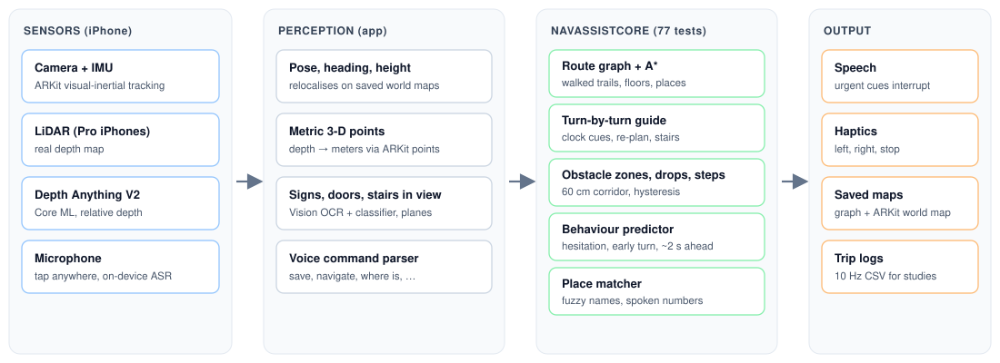
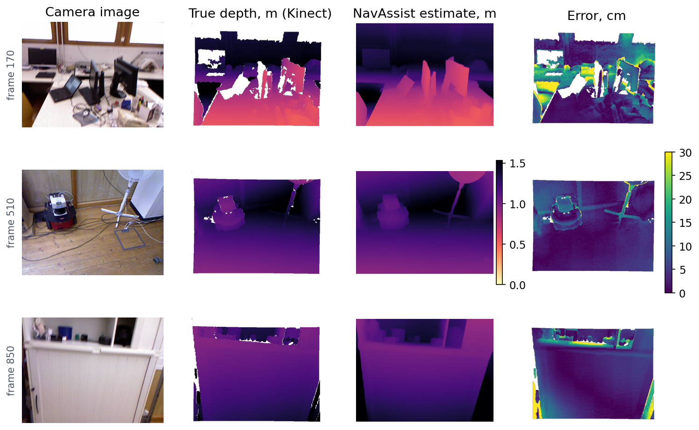
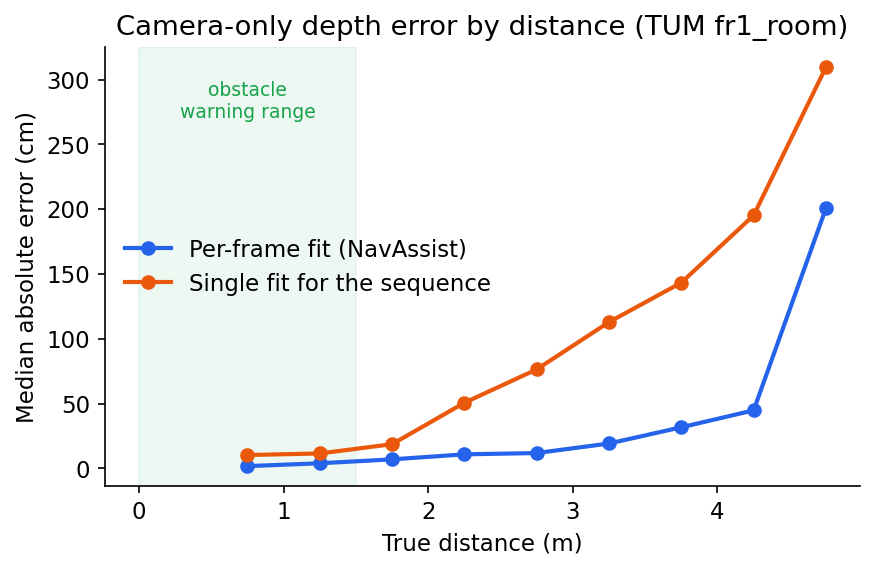
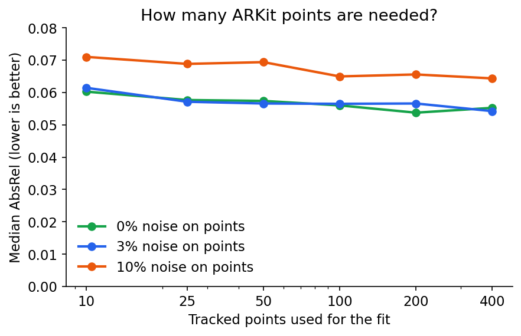
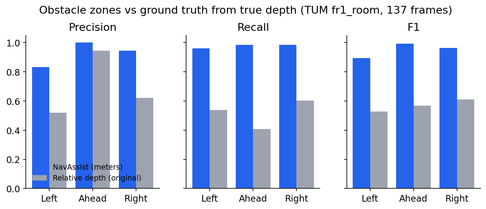
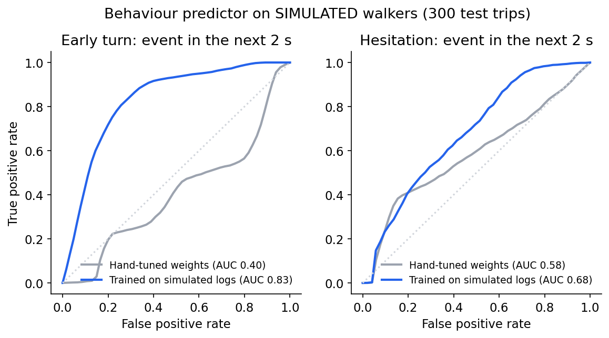

# NavAssist: voice-first indoor navigation for blind users on a commodity iPhone

*Technical report. All numbers below come from `results/` and can be regenerated with the
commands in [Reproducing the results](#reproducing-the-results).*

## Abstract

NavAssist is an iPhone app that maps indoor spaces as a user walks, and later guides them back
to saved places with spoken and haptic turn-by-turn directions. It reads signs, warns about
obstacles, doors and stairs, and is controlled entirely by voice. Phones without LiDAR have no
metric depth sensor, so we convert the monocular depth network Depth Anything V2 from relative
to metric depth every frame. The conversion is a robust inverse-depth fit to the sparse 3-D
feature points ARKit already tracks. On the TUM RGB-D `freiburg1_room` sequence this reaches
an **AbsRel of 0.070 and δ<1.25 of 95.3%**, against 0.172 and 70.0% for a single fixed
conversion. Obstacle-zone decisions made on the converted depth agree with decisions made on
true depth with an **F1 of 0.99 for the walking corridor**, against 0.57 for the relative-depth
method used in the first version. We also describe a predictor of hesitations and early turns
from motion signals. In simulation, a trained model ranks upcoming early turns well (AUC 0.83),
but at a tolerable false-alarm rate it catches only a small fraction of them. This motivates
collecting real trip logs, for which the app includes study tooling.

## 1. System overview



- **Tracking and maps.** ARKit visual-inertial odometry gives the phone's pose at 60 Hz.
  Saved ARKit world maps let the app recognise a place later. At launch, saved places are
  tried in most-recently-used order, 25 s each, before a new map is started.
- **Route graph.** The positions walked are sampled every 0.5 m into an undirected graph.
  Revisiting a node within 0.7 m on the same floor merges into it, which links separate
  walks at junctions. Nodes more than 1.2 m apart in height are never merged, so floors stay
  separate. Routes are A* over this graph, so they only use space someone has walked.
- **Guidance.** Routes are simplified (Douglas-Peucker, 0.35 m, and legs under 0.6 m merged).
  The guide announces each leg, warns 2 m before turns, gives clock-face corrections when the
  user faces away by more than 35°, re-plans after 2.5 s more than 1.5 m off route, and warns
  before stairs. Stairs are found from the recorded heights: rises of more than 30 cm per meter
  walked.
- **Voice.** On-device speech recognition and a command grammar of 70+ phrasings and patterns. A
  fuzzy place matcher joins spoken digits ("two oh four" → 204), tolerates recognition slips
  ("rest room" ↔ "Restroom"), and never matches different room numbers.
- **Signs.** Vision text recognition at 0.7 Hz, filtered by size, confidence and shape. A new
  sign is announced and stored as a destination where it was read.

## 2. Metric depth without LiDAR

Depth Anything V2 predicts *relative inverse depth*: a value that grows with closeness, with
an unknown scale and shift that change from frame to frame. ARKit, even without LiDAR,
triangulates a few hundred feature points per frame with metric 3-D positions. Projecting
those points into the image gives pairs of (network value *r*, metric depth *d*). We fit

  *r* = *a* · (1 / *d*) + *b*

by least squares. The worst 25% of pairs are then dropped and the fit is repeated, twice.
Fits with *a* ≤ 0 or R² < 0.5 are rejected. Every pixel's depth is then *d* = *a* / (*r* − *b*).
The resulting metric points are expressed relative to the walker (sideways, ahead, height above
the floor). When the fit fails, for example on a blank wall or in a dark room, the app falls
back to a stricter relative-depth check that only looks ahead.

### Experiment

**Setup.** We used the TUM RGB-D `freiburg1_room` sequence: 1,362 frames from a hand-held
Kinect with motion-capture poses and registered true depth. We took 137 frames (every 10th).
For each frame we ran the same Core ML model the app uses. To stand in for ARKit's points, we
sampled 200 pixels with valid true depth and added ±3% noise. We then ran the app's own
`InverseDepthFit` and compared the converted depth with the true depth at about 14,600 pixels
per frame. The baseline uses a *single* conversion fitted on the first frame and reused for
the whole sequence.

**Metrics.** These are the standard monocular-depth metrics: AbsRel = mean(|d̂ − d| / d), RMSE,
and δ1 = the fraction of pixels with max(d̂/d, d/d̂) < 1.25. Values are means over frames, with
95% bootstrap confidence intervals.

| Method | AbsRel ↓ | RMSE (m) ↓ | δ<1.25 ↑ | Median abs. error (m) ↓ |
|---|---|---|---|---|
| Single conversion for the sequence | 0.172 [0.151, 0.194] | 0.374 [0.320, 0.435] | 0.700 [0.639, 0.757] | 0.261 |
| **Per-frame fit to sparse points (NavAssist)** | **0.070 [0.061, 0.081]** | **0.268 [0.208, 0.342]** | **0.953 [0.942, 0.962]** | **0.060** |

All 137 frames produced a valid fit. On average 112 points were kept after trimming, with R² = 0.98.



*Figure 1. Camera image, true Kinect depth, NavAssist's converted estimate, and absolute
error. Errors concentrate at object edges and in far regions. White areas have no Kinect reading.*



*Figure 2. Median absolute error by true distance. Within the 1.5 m range used for obstacle
warnings, the per-frame fit's median error is 2–4 cm. A single conversion drifts badly beyond 2 m.*

**Ablation.** How many points are needed, and how noisy can they be?



*Figure 3. Median AbsRel against the number of points used for the fit. Accuracy is almost
flat from 25 points up, and degrades gracefully with 10% noise on the points (0.064–0.071).
ARKit typically tracks well over 25 points in a textured room.*

## 3. Obstacle zones

Obstacles are reported only inside a 60 cm walking corridor ("ahead", within 1.5 m), or
beside it when within 0.7 m ("left" / "right"). Points 12 cm to 2 m above the floor count, so
the floor is ignored and head-height obstacles are kept. Smoothing and hysteresis keep
warnings from flickering. Doors are recognised with ARKit's plane classification plus a door / door-handle / stairs
detector trained on Open Images (see `training/detector`; it replaced Apple's image classifier,
finding stairs in 79% of test pictures against 47%). Drops and steps are detected from the
walking-surface height in 25 cm slices.

### Experiment

For each of the 137 frames we built 3-D points from (i) true depth, which gives the
ground-truth zone labels, (ii) NavAssist's converted depth, and (iii) the original
relative-depth method, which compares zones against a "floor ruler" in the picture. We then
ran the app's own `MetricZoneAnalyzer` / `RelativeDepthZoneAnalyzer` on each.

| Zone | NavAssist P / R / F1 | Relative depth (original) P / R / F1 | False alarms: NavAssist vs relative |
|---|---|---|---|
| Left | 0.83 / 0.96 / 0.89 | 0.52 / 0.54 / 0.53 | 10 vs 26 |
| **Ahead** | **1.00 / 0.98 / 0.99** | 0.95 / 0.41 / 0.57 | 0 vs 3 |
| Right | 0.94 / 0.99 / 0.96 | 0.62 / 0.60 / 0.61 | 4 vs 25 |

When both flagged an obstacle ahead, the estimated distance to it was within **1.5 cm**
(median) of the true distance, and within 17 cm in 90% of frames.



*Figure 4. Agreement with ground-truth zones. The relative method misses most obstacles
ahead (recall 0.41) and raises 2–6× more false alarms at the sides. That matches what was
seen in a home test, where a basket beside the path repeatedly triggered "obstacle ahead".*

**Caveats.** The ground truth is the same analyzer run on true depth. It therefore measures
how faithfully the converted depth reproduces decisions made from true depth, not whether a
human would call something an obstacle. The hand-held recording also points at furniture
most of the time: "ahead" is blocked in 128 of 137 frames, so the "ahead" false-alarm rate
rests on only 9 clear frames. Stair detection could not be evaluated here, because the
sequence has no stairs.

## 4. Predicting hesitation and early turns

Two behaviours are labelled automatically from 10 Hz trip logs: **hesitation** (stopping for
2 s or more before arriving) and **early turns** (drifting 0.6 m or more toward the next leg
before reaching the corner). Seven features of the last 1–5 s feed two logistic regressions
that estimate the chance of each behaviour starting within 2 s: speed, slowing down, turning
rate, looking side to side, closeness to a corner, rotating toward the next leg, and sideways
drift. When a behaviour is predicted, the app speaks a corrective cue ("Not yet. Keep straight
for 2 meters more.").

### Simulation study

No real trip logs exist yet, so we simulated 600 trips: 300 for training and 300 for testing.
Each trip has a random 3–4 leg route, a walking speed of 0.6–1.2 m/s, smoothly drifting
tracking error (σ ≈ 3 cm) with heading noise, early corner-cutting at 35% of corners, and a
hesitation in 35% of trips. **These behaviours are assumptions, not data about real people.**
An event counts as predicted if the probability reached the threshold in the 3 s before it
started. An alarm onset with no event in the next 3 s counts as a false alarm. The thresholds
"for ≤ 1 false alarm/min" were chosen on the training trips.

| Model | Event | AUC | Threshold | Recall | Median lead | False alarms/min |
|---|---|---|---|---|---|---|
| Hand-tuned weights | early turn | 0.40 | 0.60 | 0.64 | 1.1 s | 2.0 |
| Trained | early turn | **0.83** | 0.60 | **0.88** | **1.9 s** | 5.8 |
| Trained | early turn | 0.83 | 0.905 (≤ 1/min) | 0.13 | 0.4 s | 0.8 |
| Hand-tuned weights | hesitation | 0.58 | 0.60 | 1.00 | 0.3 s | 1.8 |
| Trained | hesitation | 0.68 | 0.65 (≤ 1/min) | 1.00 | 0.2 s | 0.8 |



*Figure 5. ROC curves on simulated test trips.*

**Findings.**
1. The hand-tuned early-turn weights rank worse than chance (AUC 0.40), and training on logs
   raises the AUC to 0.83. Learned weights are clearly necessary.
2. At a threshold of 0.6 the trained model anticipates 88% of early turns about 2 s before
   they happen, but raises about 6 false alarms per minute. That is too many to speak aloud.
   At ≤ 1 false alarm per minute, recall drops to 13%. Smoothing the probabilities did not
   change this trade-off (see `results/simulation/predictor_events.csv`).
3. Hesitations are recognised at onset, about 2 s before they meet the "2 s stopped"
   definition, rather than predicted earlier.
4. The simulation exposed a bug: speed was computed as path length, so tracking jitter
   looked like walking and no hesitation was ever detected. Speed now uses net displacement.

Next steps are richer temporal features, or a small sequence model, trained on real trip
logs. Cues that are cheap to get wrong could also be used, such as a light haptic tick
instead of speech, to allow a lower threshold.

## 5. Planned user study

The app includes a counterbalanced, within-subject study mode: predictive cues alternate on
and off between trips, and odd- and even-numbered participants start in different conditions.
`analysis/analyze_trips.py` reports navigation errors per trip (off-route events + early
turns) with and without cues. It gives per-participant paired differences, the % reduction
with a bootstrap 95% CI, and a Wilcoxon signed-rank test. See
[research-study.md](research-study.md). Results will be added here once collected.

| | Without cues | With cues | Difference |
|---|---|---|---|
| Navigation errors per trip | — | — | — |
| Hesitations per trip | — | — | — |
| Trips reaching the destination | — | — | — |

## 6. Limitations

- Depth was evaluated on one public sequence, with simulated feature points. Real ARKit points
  are noisier and cluster on texture.
- Obstacle ground truth comes from true depth, not human judgement, and stairs were not evaluated.
- The behaviour predictor has only been tested on simulated walkers.
- Mapping needs walking routes with the app open, and recognising a place needs it to look as
  it did when mapped.

## Reproducing the results

```bash
# 1. Benchmarks (writes results/)
cd ios/NavAssistCore
swift build -c release --product navassist-eval
.build/release/navassist-eval tum path/to/DepthAnythingV2SmallF16.mlmodelc \
    ../../prototype/rgbd_dataset_freiburg1_room ../../results/tum_fr1_room 10
.build/release/navassist-eval simulate ../../results/simulation 600

# 2. Figures (writes docs/images/)
cd ../.. && python analysis/make_figures.py
```

To get the compiled `.mlmodelc`, compile the model with
`xcrun coremlcompiler compile DepthAnythingV2SmallF16.mlpackage .`, or use the copy inside
the built app. Random seeds are fixed, so the numbers are reproducible.

## References

- L. Yang et al., *Depth Anything V2*, 2024, and Apple's Core ML conversion (`apple/coreml-depth-anything-v2-small`).
- J. Sturm et al., *A Benchmark for the Evaluation of RGB-D SLAM Systems*, IROS 2012 (TUM RGB-D).
- Apple ARKit: world tracking, world maps, plane classification, and scene depth.
